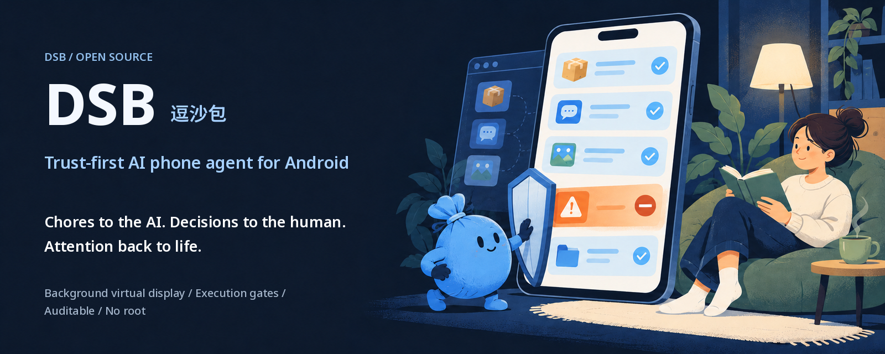
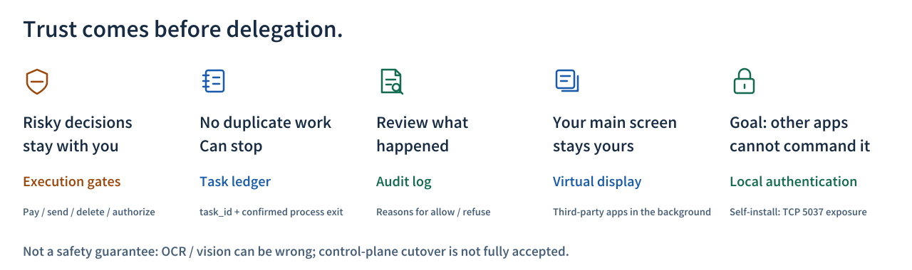
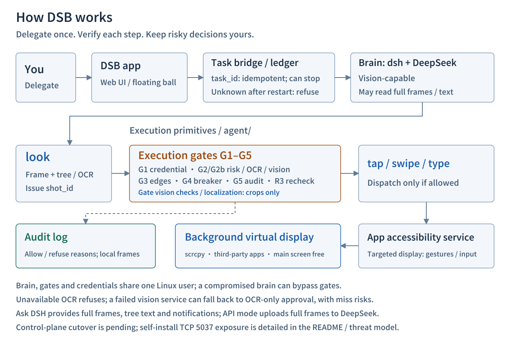

<p align="center"><b>English</b> · <a href="README.zh-CN.md">简体中文</a></p>

<p align="center">
  
</p>

# DSB (逗沙包)

[](LICENSE) [](docs/INSTALL.md) [](docs/INSTALL.md) [](https://github.com/tianye1999/dsb/actions/workflows/test.yml)

**Chores to the AI. Decisions to the human. Attention back to life.**

An open-source, **trust-first** Android AI assistant: delegate in one sentence, and it operates apps **on a background virtual display** on your own phone, using **execution gates** to block risky actions and **audit logs for screen actions**. No root; no constantly connected PC.

Think of the "AI operates your phone" category of Doubao and StepFun phones, but open-source and installed on your own device. Say "check my latest JD order"; DSB handles the app while you read or have tea.

DSB is built on the open-source [DeepSeek Harness (DSH)](https://github.com/deepseek-ai/deepseek-harness): **DSH handles conversation and reasoning; DSB handles on-phone execution, risk checks, and auditing**. The background virtual display, execution gates, task ledger, audit logs and local control plane are this project's part. DeepSeek is the default; other models are not yet covered by this project's end-to-end validation or official support (see the [roadmap](docs/ROADMAP.md#其它想做的)). This is not an official DeepSeek project.

[简体中文](README.zh-CN.md) · [Install](docs/INSTALL.md) · [Architecture](docs/ARCHITECTURE.md) · [Threat model](docs/THREAT-MODEL.md) · [Roadmap](docs/ROADMAP.md) · [Security](SECURITY.md)

## Highlights

- **Open-source phone AI assistant**: Apache-2.0; runs on your own Android 11+ phone.
- **No root, no constantly connected PC**: the runtime is on the phone.
- **Background virtual display**: third-party apps run on a scrcpy virtual display, leaving your main screen free.
- **Execution gates**: pay / send / delete / authorize controls are blocked by default.
- **Task ledger**: idempotent `task_id`, stoppable execution, and refusal of new tasks when restart state is unknown.
- **Audit log**: reasons for allowed / refused actions, with on-device frame evidence.
- **Privacy**: gate vision checks upload target-area crops only; clipboard-write receipts contain metadata, not clipboard plaintext.
- **Local control-plane authentication**: the app command entry checks the sender's system permission.
- **DSH + DeepSeek brain, with vision**: on-phone [DSH](https://github.com/deepseek-ai/deepseek-harness) does the understanding and reasoning, calling the DeepSeek API by default; other models are not yet covered by end-to-end validation or official support.
- **Installation**: the one-command installer (candidate) handles environment setup, pairing and permission guidance with one DeepSeek Key; validation so far is limited to the maintainer's device and an arm64 emulator, and fresh-install acceptance on other ROMs is still pending. See the [install guide](docs/INSTALL.md).

> **Know the boundaries:** gates are not a safety guarantee, and some data leaves your phone. Read [Boundaries and data flow](#boundaries-and-data-flow-please-read).

## Why we compete on trust

Other projects compete on how smart they are. We compete on **how trustworthy delegation can be**. Trust comes before delegation: hand off the chores, not your decisions.

<picture>
  <source media="(prefers-color-scheme: dark)" srcset="docs/assets/trust-pillars.en.dark.svg">
  
</picture>

| Why you can trust it | Engineering fact |
|---|---|
| **Risky decisions stay with you** | G1–G5 validate actions and retain evidence; R3 rechecks the frame before dispatch. |
| **No duplicate work; can stop** | Tasks are idempotent by `task_id` and report stopped only after all execution processes are confirmed exited. |
| **Review what happened** | The audit records action outcomes, allow / refuse reasons and frame evidence. |
| **Your main screen stays yours** | Third-party apps use a scrcpy background virtual display by default. |
| **Goal: other apps cannot take command** | `CmdReceiver` requires the sender to hold the `INJECT_EVENTS` system permission; the installer attempts [private ADB transport hardening](hardening/adb-private/README.md) by default and warns on preflight skips rather than claiming hardening succeeded. |

A simpler life is the result; trustworthy delegation is the cause.

## What it can do today (verified on a real device, 2026-10-21)

All read-only, all on the virtual display, all through the gates:

- JD.com: status, order time and delivery info of the latest order (it can open the order detail page)
- WeChat / Feishu (Lark): which conversations have unread messages, how many, and the last preview, **without opening any conversation**
- SMS: unread status (for verification codes it only says "there is one", never the digits)
- Chinese text input through clipboard receipts, with no plaintext logging

Every task ends with a conclusion card: the answer, where it was read from, steps and time, and how often the gates refused and why.

## How it works

<picture>
  <source media="(prefers-color-scheme: dark)" srcset="docs/assets/how-it-works.en.dark.svg">
  
</picture>

See [docs/ARCHITECTURE.md](docs/ARCHITECTURE.md).

## Installation

Installer v1 (candidate) deploys Ubuntu inside Termux, Node/dsh, Python/OCR, scrcpy, web branding and this repository's runtime files, and attempts private ADB transport hardening by default. It requires Android 11+ and a 64-bit phone, with no root; the only service configuration is a DeepSeek API Key, entered once with hidden input.

Steps: **install official Termux and DSB -> run one command in Termux -> enter the Key -> personally pair and grant permissions through the system prompts -> doctor**. Full commands, resume and rollback instructions are in [docs/INSTALL.md](docs/INSTALL.md).

For device identifiers, connection targets and fixed local defaults, see [device-specific values](docs/INSTALL.md#设备相关数值哪些需要调整) (Chinese).

```bash
curl -fL https://github.com/tianye1999/dsb/releases/download/v1.0.0/dsb-installer.tar.gz -o ~/dsb-installer.tar.gz && printf '%s  %s\n' 'c140d4c71a0afbb1d9b24ca81eb43dba870bc99cdc3765fc990f24abe2d1af56' "$HOME/dsb-installer.tar.gz" | sha256sum -c - && tar -xzf ~/dsb-installer.tar.gz -C ~ && bash ~/dsb-installer/install.sh
```

The download command pins the release tarball's SHA-256 (matching `SHA256SUMS` in the [v1.0.0 release](https://github.com/tianye1999/dsb/releases/tag/v1.0.0)); nothing is unpacked or run unless it verifies. The APK is signed with the maintainer's existing release key, and the installer accepts it only after checking the pinned signing-certificate SHA-256. The all-in-one APK that needs no separate setup remains on the [roadmap](docs/ROADMAP.md).

## Roadmap (planned, not implemented)

Home-screen widget · on-device wake word (no audio upload) · voice interaction (ASR + TTS) · pluggable brain · one-click installer release · all-in-one APK. See [docs/ROADMAP.md](docs/ROADMAP.md).

**Trust hardening (planned, not implemented)**: crop-first / disable-full-frame controls for questions, refusal of empty-tree taps when vision fails, and audit free-text redaction. See the [trust-hardening roadmap](docs/ROADMAP.md#可信加固兑现更强承诺).

## Boundaries and data flow (please read)

### Gates can misclassify; failed vision can fall back to OCR

OCR can miss risks, and vision can be wrong. Empty-tree pages refuse when OCR is unavailable, or when a successful vision response reports `external` / `irreversible` / `unclear`. **If the vision service fails, OCR has found no dangerous words, the caller has acknowledged the frame, and other gate conditions pass, current code can still approve using OCR alone**; detected dangerous words instead cause refusal. Gates are not a safety guarantee, and the whole system is not uniformly fail-closed. Evidence: [OCR checks](agent/safe_tap.py#L1470), [vision verdicts and fallback](agent/safe_tap.py#L1514).

### The brain and gates are not strongly isolated

The brain, gates and credentials share one Termux Linux user. Gates constrain mistakes, not a compromised brain rewriting or bypassing them; screen-action audit logs do not cover every bash command. Evidence: [brain process permissions](bridge/bridge.mjs#L122); full [trust boundaries](docs/THREAT-MODEL.md#信任边界).

### Crop-only vision does not cover full-screen questions

Gate vision checks send target-area crops; localization sends a crop of the requested region. See [gate crops](agent/vision_check.py#L36) and [localization crops](agent/vision_check.py#L114). **"Ask DSH" has a separate full-frame path**: the app provides a screenshot, accessibility-tree text and recent notifications to the brain. API mode uploads the full frame to the default DeepSeek API; the dsh path is also instructed to use `read_image` on the full screenshot. dsh's internal image transport is not implemented in this repository, so crop-only transmission cannot be promised for it. Task and page text may also reach cloud models; on-phone dsh does not mean an offline model. Evidence: [app question input](app/src/com/dsb/assistant/OverlayService.java#L2241), [question bridge](bridge/bridge.mjs#L523), [API upload](bridge/bridge.mjs#L144), [dsh image entry](bridge/bridge.mjs#L170).

### TypeSafe adds an optional cloud-review path

With a TypeSafe Key configured, suspicious shell-command excerpts (up to 1500 characters), the tool name and matched risk hints go to TypeSafe's cloud service. This command hook fails open if the service is unavailable; it does not replace screen execution gates. Evidence: [review input](agent/check_gate.py#L151), [endpoint and key loading](agent/jev_client.py#L23), [unavailable-service behavior](agent/check_gate.py#L162).

### Session-log uploads and feedback are separate paths

The public web, phone and headless [patch layers](dsh-config/) set `session-log-deepseek.enabled: false`. Upstream enables it by default and attaches complete session events to official DeepSeek API requests. Disabling it does not stop ordinary model requests from leaving the phone or delete local history. Re-enabling can upload events accumulated while disabled. Installation and snapshot sync retain the public default; the patch takes precedence over the Web form. Verify with `dsh --profile <p> --dump-config` without sharing the full dump.

Separately, `session-telemetry-otel` defaults to `FEEDBACK_ONLY`: explicit message ratings or session feedback authorize sending that session log to DeepSeek, and feedback-authorized sessions may replay when loaded later. DSB disables that feedback UI, including its `/feedback` form, not every underlying feedback API. The account menu's Feedback entry instead opens [DSB GitHub Issues](https://github.com/tianye1999/dsb/issues) without automatically attaching session, account or device details. Remove sensitive content before posting publicly. `desktop-product-telemetry` activates only for a profile named `desktop`, not the phone's web/phone/headless profiles; other data paths remain independent. Based on the pinned [DSH 0.2.1-rc.2 release](https://www.npmjs.com/package/@deepseek-ai/dsh/v/0.2.1-rc.2); verify the effective value with `dsh --profile <p> --dump-config`.

### Audit logs are not an automatic redaction boundary

Clipboard-write receipts record operation, outcome, length and related metadata, not clipboard plaintext; see [receipt validation](agent/safe_tap.py#L2214). Clearing after paste is attempted and its receipt checked; failures are recorded, so clearing is not guaranteed ([clearing flow](agent/safe_tap.py#L2252)). This **does not imply zero-plaintext logs**: audit `note` / `expect` / vision explanations are not uniformly redacted and may contain chat, order or other page content. Before/after action frames and question screenshots are also written on the phone. Inspect sensitive content before sharing logs or images. Evidence: [direct audit serialization](agent/safe_tap.py#L349), [action record fields](agent/safe_tap.py#L1923), [question-image persistence](bridge/bridge.mjs#L87).

### Control-plane lockdown still has deployment and acceptance gaps

App command entry requires the `INJECT_EVENTS` system permission; tasks use Termux `RUN_COMMAND` and private sockets. On 2026-10-23, the maintainer's device migrated to the same private transport layout as the installer and passed acceptance including one reboot: only one managed server started after reboot, identity was automatically reverified and bound, and doctor, the background virtual display and real tasks passed. Package-upgrade acceptance has not been performed; in-flight tasks retain separate acceptance boundaries. The repository's installer uses a private bootstrap from first pairing and attempts ADB hardening by default; ordinary TCP after a preflight skip or rollback is a weaker fallback, and the "ADB not hardened" warning must not be ignored. The public tool still does not migrate legacy deployments. The generic installer remains a candidate; results on the maintainer's device or limited emulator tests do not prove lockdown on every device. Evidence: [entry permission](app/AndroidManifest.xml), [task transport](app/src/com/dsb/assistant/DshClient.java), [private listener](bridge/private-listener.mjs) and the [control-plane section](docs/THREAT-MODEL.md#4-控制权--本地控制面鉴权).

## Known limitations

- Pages that show dangerous words (e.g. an order list with a permanent "delete order" button) **cannot be scrolled**; only the first screen is read. This is the gate working as designed.
- Taps on pages without an accessibility tree rely on the vision model; the top/bottom edges of very tall buttons are covered by vision only.
- After a reboot you must unlock the phone once before the system delivers the boot broadcast.
- Speed depends on the model and the phone load: a task usually takes 2–8 minutes, mostly spent waiting for the model.

## Responsible use

- DSB automates third-party apps. **This may violate their terms of service or trigger their anti-automation controls.** Use it only on your own accounts and devices, at your own risk.
- It is not a defensive tool. The threat model states what it does **not** protect against: an attacker with root, authorized ADB or Termux execution rights is at the same trust level as DSB itself.
- The brain runs with full permissions in the same Linux user as the gates. The gates protect against the brain *making mistakes*, not against the brain *being compromised*.

## License

[Apache-2.0](LICENSE). Third-party components: [NOTICE](NOTICE).
