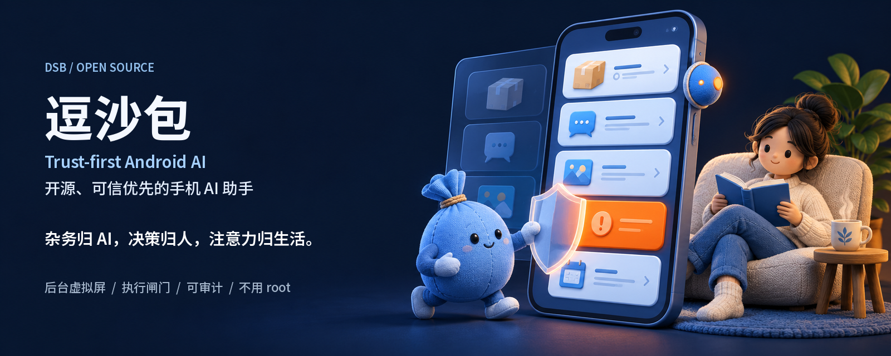
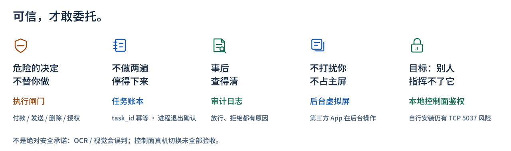
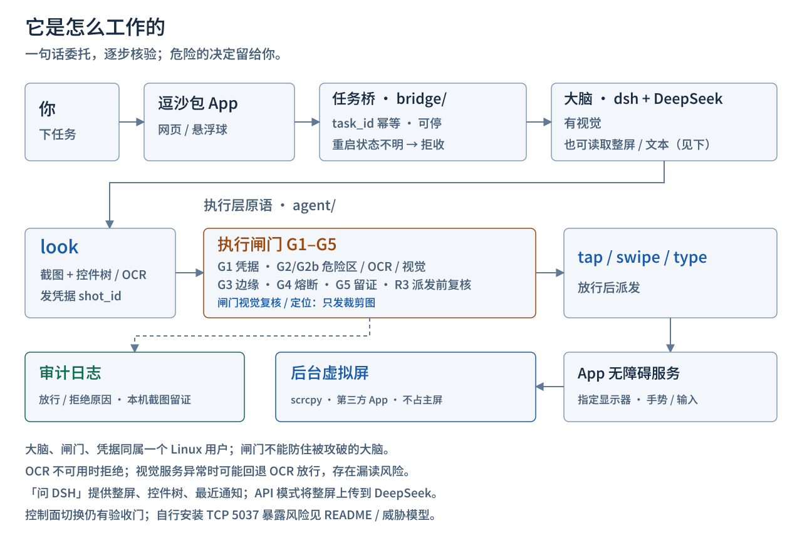

<p align="center"><a href="README.md">English</a> · <b>简体中文</b></p>

<p align="center">
  
</p>

# 逗沙包（DSB）

[](LICENSE) [](docs/INSTALL.zh-CN.md) [](docs/INSTALL.zh-CN.md) [](https://github.com/tianye1999/dsb/actions/workflows/test.yml) [](https://www.bestpractices.dev/projects/15815)

**杂务归 AI，决策归人，注意力归生活。**

开源、**可信优先**的 Android 手机 AI 助手：一句话让 AI 在你自己手机的**后台虚拟屏**替你操作 App，用**执行闸门**拦截危险操作，屏幕动作**可审计**；不用 root，不用电脑常连。

像豆包手机、阶跃星辰手机那类「AI 替你操作手机」，但开源，装在你自己的手机上。你说「看看京东最新的订单到哪了」，它在后台翻订单，你继续喝茶、看书。

逗沙包构建在开源的 [DeepSeek Harness（DSH）](https://github.com/deepseek-ai/deepseek-harness)之上：**DSH 负责对话与推理，逗沙包负责手机端执行、风险拦截与审计**——后台虚拟屏、执行闸门、任务账本、审计与本地控制面都是本项目的部分。默认使用 DeepSeek；其他模型尚未纳入本项目的端到端验收与正式支持范围，见[路线图](docs/ROADMAP.zh-CN.md#其它想做的)。本项目不是 DeepSeek 官方项目。

[English](README.md) · [安装](docs/INSTALL.zh-CN.md) · [架构](docs/ARCHITECTURE.zh-CN.md) · [威胁模型](docs/THREAT-MODEL.zh-CN.md) · [路线图](docs/ROADMAP.zh-CN.md) · [安全策略](SECURITY.zh-CN.md)

## 亮点

- **开源手机 AI 助手**：Apache-2.0，装在你自己的 Android 11+ 手机上。
- **不用 root、不用电脑常连**：运行环境在手机上。
- **后台虚拟屏、不占主屏**：第三方 App 在 scrcpy 虚拟屏上操作。
- **执行闸门**：付款、发送、删除、授权这类危险控件默认拦截。
- **任务账本**：`task_id` 幂等、可停，重启后状态不明时拒收新任务。
- **审计日志**：记录动作放行 / 拒绝原因，保留本机截图证据。
- **隐私**：闸门视觉复核只发目标附近的裁剪图；剪贴板写入只记回执。
- **本地控制面鉴权**：App 命令入口以系统权限校验发送方。
- **大脑 DSH + DeepSeek（有视觉）**：理解与推理由手机上的 [DSH](https://github.com/deepseek-ai/deepseek-harness) 完成，默认调用 DeepSeek API；其他模型尚未纳入端到端验收与正式支持范围。
- **安装**：一键安装器（候选版）负责环境、配对和授权引导，只需一个 DeepSeek Key；验证范围目前限于维护者的一台真机与 arm64 模拟器，通用安装器仍待完成冻结首装和不同 ROM 验收，见[安装说明](docs/INSTALL.zh-CN.md)。

> **边界先说清：** 闸门不是绝对保证、哪些数据会离开手机——见[边界与数据流（请先读）](#边界与数据流请先读)。

## 为什么卷「可信」

别的项目卷「多聪明」，我们卷「多可信」：**可信才是委托的前提。** 不是让 AI 替你决定，而是让你敢把杂务交出去。

<picture>
  <source media="(prefers-color-scheme: dark)" srcset="docs/assets/trust-pillars.zh.dark.svg">
  
</picture>

| 你凭什么信它 | 工程事实 |
|---|---|
| **危险的决定不替你做** | G1–G5 负责动作校验与留证，R3 在派发前复核画面。 |
| **不做两遍，停得下来** | 任务按 `task_id` 幂等，确认执行进程全部退出后才报告停止。 |
| **事后查得清** | 审计记录动作结果、放行 / 拒绝原因与截图证据。 |
| **不打扰你** | 第三方 App 默认通过 scrcpy 后台虚拟屏操作。 |
| **目标：别人指挥不了它** | `CmdReceiver` 要求发送方持有 `INJECT_EVENTS` 系统权限；安装器默认尝试 [ADB 私有传输加固](hardening/adb-private/README.zh-CN.md)，预检跳过会警告，不冒充已加固。 |

极简生活是果，可信委托是因。

## 现在能做什么（2026-10-21 真机验收）

全部只读、全部在虚拟屏上、全部走闸门：

- 京东：读最新一笔订单的状态、下单时间、配送信息（能进订单详情）
- 微信 / 飞书：会话列表层面读出哪些有未读、各几条、最后一条预览——**不点进任何会话**，未读不会变已读
- 短信：读未读情况（验证码只说「有」，不念数字）
- 中文输入：通过 App 剪贴板回执写入，不记录原文

每个任务做完给一张结论卡：答案、证据来源、步数耗时、被闸门拒绝了几次和为什么。

## 它是怎么工作的

<picture>
  <source media="(prefers-color-scheme: dark)" srcset="docs/assets/how-it-works.zh.dark.svg">
  
</picture>

详见 [docs/ARCHITECTURE.zh-CN.md](docs/ARCHITECTURE.zh-CN.md)。

## 安装

安装器 v1（候选版）部署 Termux 内的 Ubuntu、Node/dsh、Python/OCR、scrcpy、网页品牌与本仓库运行文件，默认尝试 ADB 私有传输加固。需要 Android 11+、64 位手机，不用 root；唯一服务配置是 DeepSeek API Key，隐藏输入一次。

实际步骤：**装官方 Termux 和逗沙包 → Termux 跑一条命令 → 填 Key → 按系统提示本人配对/授权 → doctor**。完整命令、续装和回滚见 [docs/INSTALL.zh-CN.md](docs/INSTALL.zh-CN.md)。

设备标识、连接目标与固定端口是否需要调整，见[设备相关数值](docs/INSTALL.zh-CN.md#设备相关数值哪些需要调整)。

```bash
curl -fL https://github.com/tianye1999/dsb/releases/download/v1.0.2/dsb-installer.tar.gz -o ~/dsb-installer.tar.gz && printf '%s  %s\n' 'd1a782b337802c24b29ab36cdb0dfb3ac8e79b45e826b789ef5e773d4fc08553' "$HOME/dsb-installer.tar.gz" | sha256sum -c - && tar -xzf ~/dsb-installer.tar.gz -C ~ && bash ~/dsb-installer/install.sh
```

下载命令内联了发布包的 SHA-256（与 [v1.0.2 Release](https://github.com/tianye1999/dsb/releases/tag/v1.0.2) 附带的 `SHA256SUMS` 一致），校验不通过就不会解包执行。APK 用维护者现有发布密钥签名，安装器按固定的证书 SHA-256 验签后才接受。「装一个 App 就够」的全合一 APK 仍在[路线图](docs/ROADMAP.zh-CN.md)上。

## 路线图（计划中，未实现）

桌面小组件 · 本机唤醒词（不上传录音） · 语音交互（ASR + TTS） · 可替换的大脑底座 · 一键安装器 · 全合一 APK。详见 [docs/ROADMAP.zh-CN.md](docs/ROADMAP.zh-CN.md)。

**可信加固（计划中、未实现）**：整屏问答裁剪优先 / 可关闭整屏上传、视觉异常时空树页点击拒绝、审计自由文本脱敏，见[可信加固路线图](docs/ROADMAP.zh-CN.md#可信加固兑现更强承诺)。

## 边界与数据流（请先读）

### 闸门会误判，视觉异常时仍可能回退放行

OCR 可能漏读，视觉也可能判断错。空控件树页的 OCR 不可用时会拒绝；视觉返回 `external` / `irreversible` / `unclear` 时也会拒绝。**视觉服务异常时，如果 OCR 未检出危险词、调用方已确认看过截图且其余闸门条件满足，当前代码仍可能仅凭 OCR 放行**；如果已检出危险词则拒绝。因此不能把闸门当作绝对安全保证，也不能把整个系统称为全部 fail-closed。依据：[OCR 检查](agent/safe_tap.py#L1477)、[视觉判断与回退分支](agent/safe_tap.py#L1516)。

### 大脑与闸门没有强隔离

大脑、闸门和凭据处在同一个 Termux Linux 用户下。闸门用于约束大脑误操作，不能防住已被攻破的大脑改写或绕过闸门；屏幕动作审计也不等于所有 bash 命令都被审计。依据：[大脑进程的运行权限](bridge/bridge.mjs#L122)；完整信任边界见[威胁模型](docs/THREAT-MODEL.zh-CN.md#信任边界)。

### 裁剪图承诺不覆盖整屏问答

闸门视觉复核只发送目标附近裁剪图，视觉定位只发送指定区域裁剪图，见[复核裁剪](agent/vision_check.py#L36)与[定位裁剪](agent/vision_check.py#L114)。**「问 DSH」另有整屏路径**：App 将整屏截图、控件树、最近通知交给大脑；API 模式直接把整屏上传到默认的 DeepSeek API，dsh 路径也会被引导用 `read_image` 读取完整截图。dsh 内部图片传输实现不在本仓库，不能据此承诺只外发裁剪图。任务和页面文本也可能进入云端模型；dsh 在手机上运行，不代表模型离线运行。依据：[App 问答输入](app/src/com/dsb/assistant/OverlayService.java#L2273)、[问答桥接](bridge/bridge.mjs#L548)、[API 上传](bridge/bridge.mjs#L144)、[dsh 看图入口](bridge/bridge.mjs#L170)。

### TypeSafe 是另一条可选的云端判定路径

配置 TypeSafe Key 后，命中可疑特征的 shell 命令片段（最多 1500 字符）、工具名称和命中特征会交给 TypeSafe 云端服务判定；该命令钩子在服务不可用时按 fail-open 放行，不替代屏幕执行闸门。依据：[判定输入](agent/check_gate.py#L151)、[服务地址与密钥读取](agent/jev_client.py#L23)、[不可用时放行](agent/check_gate.py#L162)。

### DSH 会话日志上传与反馈不是同一条路径

公开版的 web / phone / headless [配置补丁](dsh-config/)均将 `session-log-deepseek.enabled` 设为 `false`。
上游默认开启时，调用 DeepSeek 官方 API 会随请求发送完整会话事件日志；关闭这个开关**不等于模型请求不外发**，也不会删除本机日志。
重新开启后，关闭期间积累的事件可能补传。安装器和副本同步保留这个公开默认值；补丁层优先于网页表单，须用 `dsh --profile <p> --dump-config` 核对生效值。

另一条 `session-telemetry-otel` 路径默认是 `FEEDBACK_ONLY`：只有主动提交消息赞/踩或会话反馈，才授权把该会话日志发给 DeepSeek；不是日常自动上传，但已有反馈会话可在后续装载时重放。逗沙包 web 停用该消息反馈 UI（含 `/feedback` 表单），不声称停用了底层所有反馈接口。
“更多 → 意见反馈”改为打开 [逗沙包 GitHub Issues](https://github.com/tianye1999/dsb/issues)，不会自动附带会话、账号或设备信息；公开发帖前仍需自行去除敏感内容。
`desktop-product-telemetry` 只在 profile 名为 `desktop` 时启用，手机使用的 web / phone / headless 不启用它；这不代表以上其他路径被一并关闭。
实现依据为固定的 [DSH 0.2.1-rc.2 发布包](https://www.npmjs.com/package/@deepseek-ai/dsh/v/0.2.1-rc.2)；用 `dsh --profile <p> --dump-config` 核对生效值。

### 审计不是自动脱敏的保险箱

剪贴板写入回执只记操作、结果、长度等元数据，不记剪贴板原文，见[回执核验](agent/safe_tap.py#L2233)；粘贴后会尝试清空并核验回执，清空失败也会记录，不能视为必然成功，见[清空流程](agent/safe_tap.py#L2252)。这**不等于所有日志零原文**：审计中的 `note` / `expect` / 视觉解释没有统一脱敏，可能带入聊天、订单等页面内容；动作前后截图与问答截图也会在本机落盘。分享日志、截图前应先检查敏感内容。依据：[审计直接序列化](agent/safe_tap.py#L369)、[动作记录字段](agent/safe_tap.py#L1943)、[问答截图落盘](bridge/bridge.mjs#L87)。

### 控制面收口仍有部署与验收缺口

App 命令入口要求 `INJECT_EVENTS` 系统权限；任务通道使用 Termux `RUN_COMMAND` 与私有套接字。维护者设备于 2026-10-23 迁移到与安装器相同的私有传输布局，并通过含一次重启的验收：重启后只起一个受管 server，自动重新核验并绑定，doctor、后台虚拟屏与真实任务均通过；软件包升级已在 arm64 模拟器上验收（真实 `pkg upgrade` 后原版 adb 无法加载，私有 ADB 与 doctor 正常），维护者真机上的软件包升级验收尚未做；在途任务仍有单独验收边界。仓库安装器从首次配对起使用私有 bootstrap，并默认尝试收紧 ADB；预检跳过或回滚后的普通 TCP 是较弱回退，不能忽略「ADB 未加固」警告。公开工具仍不迁移旧版部署；通用安装器仍处候选验收，不把维护者设备或有限模拟器结果当成所有设备都已完成收口。依据：[入口权限](app/AndroidManifest.xml#L99)、[任务传输](app/src/com/dsb/assistant/DshClient.java)、[私有监听](bridge/private-listener.mjs)及[控制面说明](docs/THREAT-MODEL.zh-CN.md#4-控制权--本地控制面鉴权)。

## 已知限制

- 有危险词的页面（比如订单列表上常驻「删除订单」）**不能滚动**，只能看首屏；这是闸门的预期行为，不是 bug
- 空控件树页面的点击依赖视觉模型判断，很高的按钮上下边缘只靠视觉兜底
- 重启手机后要解锁一次，系统才会发开机广播，它才会自动就位
- 模型和手机负载会影响速度：一个任务通常 2–8 分钟，其中大部分时间在等模型思考

## 负责任使用

- 逗沙包自动操作的是第三方 App。**这可能违反那些 App 的服务条款，或触发它们的风控**（例如电商平台对自动化访问的限制）。请只在自己的账号、自己的设备上使用，后果自负。
- 它不是防御工具：威胁模型里写明了它**不能**防住什么。已经拿到 root、ADB 授权或 Termux 执行权的攻击者，和它处于同等信任级别。
- 大脑跑在完全权限模式下。它和闸门在同一个 Linux 用户下运行，闸门防的是「大脑犯错」，不是「大脑被攻破」。

## 许可证

[Apache-2.0](LICENSE)。第三方组件见 [NOTICE](NOTICE)。
